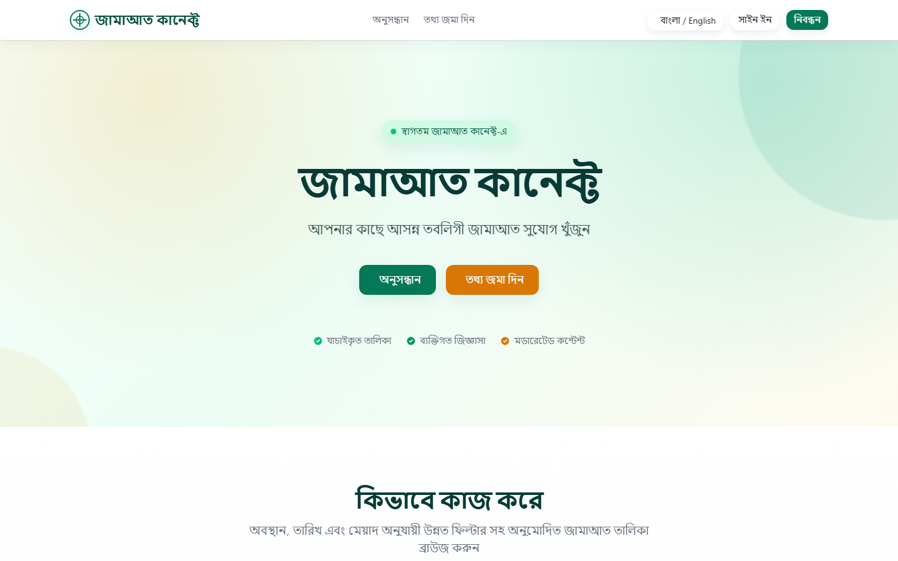
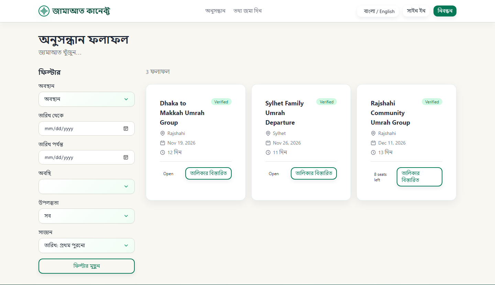
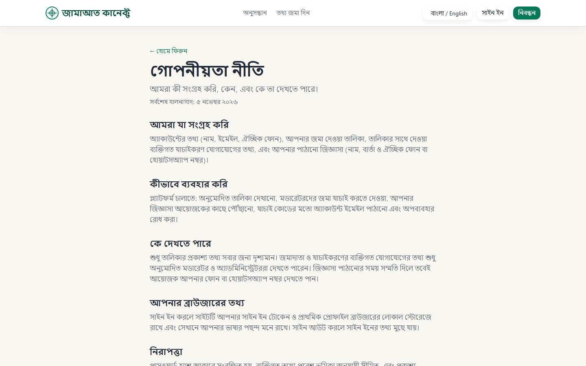

<div align="center">

# 🕌 Jamaat Connect

### Discover upcoming Jamaat opportunities. Privately. Responsibly.

A community-driven web platform that helps people in Bangladesh find upcoming Tablighi Jamaat listings, submit new ones through a moderated workflow, and contact organizers without exposing private details.


**বাংলা** · **English**

</div>

---

## ✨ Why Jamaat Connect?

Information about upcoming Jamaat departures usually travels through personal contacts, local mosques, messaging groups, and word of mouth. That makes it hard to find, easy to get wrong, and invisible to newcomers.

Jamaat Connect gives the community one trusted place to look, built around three principles:

| | Principle | What it means |
|---|---|---|
| 🔍 | **Discoverable** | Search by location, departure date, duration, and availability. No account needed to browse. |
| 🛡️ | **Moderated** | Anyone can submit a listing, but nothing goes public until a moderator approves it. |
| 🔒 | **Private** | Organizer phone numbers and addresses are never exposed publicly. Contact is shared only with explicit consent. |

---

## 🖼️ Screenshots

<div align="center">

| Home | Search |
|---|---|
|  |  |

| Privacy Policy |
|---|
|  |

</div>

---

## 📱 Features

### For visitors
- Browse approved listings with filters, sorting, and pagination
- Hierarchical location search (Division → District → Upazila)
- Detailed listing pages
- Send a private enquiry to an organizer, with optional phone/WhatsApp sharing by consent
- Report misleading or abusive listings
- Switch between **Bengali** and **English**

### For submitters and organizers
- 5-step submission form with live preview
- Reference ID and status tracking (pending, changes requested, approved, rejected)
- Organizer verification status
- Private verification contact information kept off the public API

### For moderators and admins
- Moderation queue with Approve, Request Changes, Reject, and Suspend actions
- Private submitter details visible only to authorized roles
- Self-approval prevention enforced server-side
- Report and abuse handling

### Built-in safeguards
- JWT authentication with policy-based role authorization (ASP.NET Core Identity)
- Rate limiting on public endpoints
- FluentValidation on every DTO
- Public/private data separation verified at the API layer
- Health endpoints: `/health` and `/health/ready`

---

## 🧱 Tech Stack

| Layer | Technology |
|---|---|
| **Frontend** | Angular 21 (standalone components, signals, reactive forms), Tailwind CSS 4 |
| **Backend** | ASP.NET Core Web API on .NET 10, Clean Architecture |
| **Data** | PostgreSQL 16, Entity Framework Core 10 (Npgsql) |
| **Auth** | ASP.NET Core Identity + JWT bearer tokens |
| **Validation** | FluentValidation |
| **Infrastructure** | Docker, Docker Compose, nginx |

---

## 🏗️ Architecture

```
┌──────────────────────┐        REST / JSON        ┌───────────────────────────────┐
│  Angular 21 SPA      │ ────────────────────────▶ │  JamaatConnect.Api            │
│  (nginx container)   │                           │  Controllers · Auth · Limits  │
└──────────────────────┘                           └───────────────┬───────────────┘
                                                                   │
                                                   ┌───────────────▼───────────────┐
                                                   │  JamaatConnect.Application    │
                                                   │  Services · DTOs · Validators │
                                                   └───────────────┬───────────────┘
                                                                   │
                              ┌────────────────────────────────────┼──────────────┐
                              │                                    │              │
                  ┌───────────▼──────────┐             ┌───────────▼──────────┐    │
                  │  JamaatConnect.Domain│◀────────────│  Infrastructure      │    │
                  │  Entities · Enums    │             │  EF Core · Email     │    │
                  └──────────────────────┘             └───────────┬──────────┘    │
                                                                   │               │
                                                          ┌────────▼────────┐      │
                                                          │  PostgreSQL 16  │◀─────┘
                                                          └─────────────────┘
```

Full details live in [`doc/ARCHITECTURE.md`](doc/ARCHITECTURE.md).

---

## 🚀 Getting Started

### Prerequisites
- [Docker Desktop](https://www.docker.com/products/docker-desktop/)
- *(Optional, for local development)* [.NET 10 SDK](https://dotnet.microsoft.com/) and [Node.js](https://nodejs.org/) with npm

### Run with Docker

```bash
# 1. Clone
git clone https://github.com/infinityabir/jamaat-connect.git
cd jamaat-connect

# 2. Configure environment
cp .env.example .env        # then edit values as needed

# 3. Start the database, API, and frontend
docker compose up --build
```

On Windows you can also double-click `start.bat` (and `stop.bat` to shut everything down). `docker-compose.dev.yml` is an experimental development override and is not used by default.

| Service | URL |
|---|---|
| Frontend | http://localhost:4200 |
| API | http://localhost:5000 |
| PostgreSQL | `localhost:5432` |

Migrations and seed data (Bangladesh divisions, districts, and upazilas) are applied automatically on startup.

### Run without Docker

```bash
# Backend (needs a local PostgreSQL matching appsettings.json)
dotnet run --project src/backend/JamaatConnect.Api

# Frontend
cd src/frontend
npm install
npm start
```

### Email (SMTP)

Set the `SMTP_*` values in `.env` to send real email. Without them, the app falls back to a development mode.

> ⚠️ Never commit your `.env` file. It is git-ignored by default.

---

## 📂 Project Structure

```
Jamaat Connect/
├── src/
│   ├── backend/
│   │   ├── JamaatConnect.Api/             # Controllers, startup, auth, rate limiting
│   │   ├── JamaatConnect.Application/     # Services, DTOs, validators, interfaces
│   │   ├── JamaatConnect.Domain/          # Entities, enums, value objects
│   │   └── JamaatConnect.Infrastructure/  # EF Core, migrations, email, seeding
│   └── frontend/
│       └── src/app/
│           ├── core/                      # Guards, interceptors, services
│           ├── layout/                    # Header, footer
│           ├── shared/                    # Reusable components and pipes
│           └── features/                  # home, listings, enquiries, moderation,
│                                          # organizer, admin, auth, profile
├── doc/                                   # BRD, architecture, design, decisions, status
├── docker-compose.yml
└── .env.example
```

---

## 🗺️ Roadmap

| Phase | Focus | Status |
|---|---|---|
| 1 | Foundation and design system | ✅ Done |
| 2 | Data model and discovery | ✅ Done |
| 3 | Submissions, enquiries, moderation | ✅ Done |
| 4 | Security and quality (tests, accessibility audit) | 🚧 In progress |
| 5 | Deployment readiness (HTTPS, logging, backups) | 🚧 In progress |

Track the details in [`doc/STATUS.md`](doc/STATUS.md).

**Out of scope for the MVP:** native mobile apps, GPS tracking, payments, public participant directories, and AI-generated religious advice.

---

## 📚 Documentation

| Document | Purpose |
|---|---|
| [`doc/BRD.md`](doc/BRD.md) | Business requirements |
| [`doc/ARCHITECTURE.md`](doc/ARCHITECTURE.md) | System architecture |
| [`doc/DESIGN.md`](doc/DESIGN.md) | UI/UX and behavior |
| [`doc/CONVENTIONS.md`](doc/CONVENTIONS.md) | Coding conventions |
| [`doc/DECISIONS.md`](doc/DECISIONS.md) | Technical decisions log |
| [`doc/STATUS.md`](doc/STATUS.md) | Implementation progress |
| [`doc/BACKUP_RESTORE.md`](doc/BACKUP_RESTORE.md) | PostgreSQL backup and restore |
| [`doc/MANUAL_TESTING_CHECKLIST.md`](doc/MANUAL_TESTING_CHECKLIST.md) | Manual QA checklist |

---

## 🔐 Privacy and Responsibility

Jamaat Connect never claims that a person or Jamaat is religiously endorsed, and a submission does not make the submitter an official organizer. Private contact details stay private, and the platform collects only what it needs to run discovery and moderation.

---

## 📄 License

Released under the [MIT License](LICENSE).

---

## 🤝 Contributing

Issues and pull requests are welcome. Please read [`doc/CONVENTIONS.md`](doc/CONVENTIONS.md) first and keep changes aligned with the requirements in [`doc/BRD.md`](doc/BRD.md).

---

<div align="center">

Built with care for the community by [@infinityabir](https://github.com/infinityabir)

</div>
